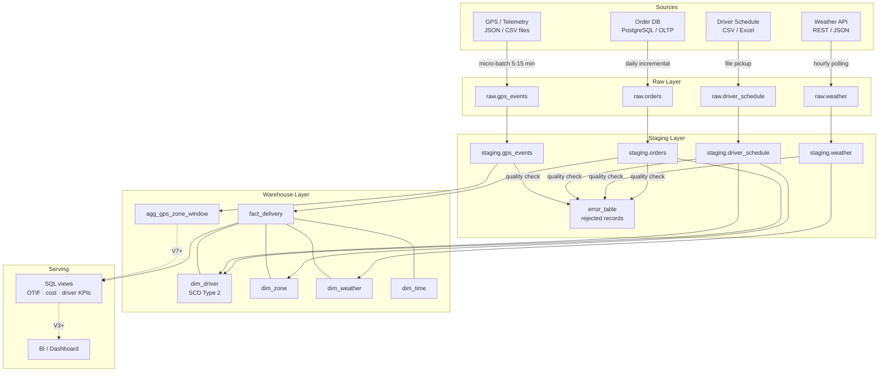

# Logistics DE Platform

A data engineering project that will consolidate order, weather, driver-schedule, and GPS data into a star-schema warehouse to track OTIF, cost, and driver performance.

**Status:** 🚧 In progress — V0 in final review; V1 next

---

## 1. Business Problem

A last-mile delivery company has no centralized way to track its own delivery performance. Operational data is scattered across an order database, manually exported driver schedules (Excel/CSV), and raw GPS logs that are never analysed. Different departments calculate "on time" differently and learn about problems too late to act.

Consequences:
- Operations only learns a zone is struggling **after** customers complain
- Finance discovers cost overruns at month-end, when it is too late to act
- Customer service cannot explain *why* an order was late and answers complaints with guesses
- Management receives reports where "on time" is calculated differently by each team

**The platform's purpose:** consolidate these sources into a single, trusted analytical dataset with one agreed definition per KPI, refreshed automatically, with data quality problems detected and recorded instead of silently corrupting reports.

---

## 2. Stakeholders

| Stakeholder | Role | Representative question |
|---|---|---|
| **Ops team** | Assigns drivers to zones; makes reinforcement decisions several times a day | *"Which zones have an on-time rate noticeably below their own normal level today?"* (BQ-OPS-2) |
| **Finance** | Controls delivery operating cost | *"Which zones cost more per order than the city-wide average, and by how much?"* (BQ-FIN-2) |
| **Customer Service** | Handles complaints about late deliveries | *"Was there bad weather in the delivery zone at the time of this order?"* (BQ-CS-3) |
| **Management** | Monitors overall performance and allocates resources | *"Is OTIF improving or declining over the last 12 weeks?"* (BQ-MGT-3) |

See [v0-requirements.md §2](docs/architecture/v0-requirements.md) for the full list of business questions per stakeholder group.

---

## 3. Data Sources

| # | Source | Format | Frequency | Origin |
|---|--------|--------|-----------|--------|
| 1 | Order & Delivery DB (PostgreSQL, OLTP) | Relational tables | Batch, daily incremental | 🔧 Simulated |
| 2 | Weather API (Open-Meteo or equivalent) | JSON via REST | Scheduled polling, hourly | 🌐 Real public API |
| 3 | Driver Schedule CSV | CSV / Excel | Batch, per shift / day | 🔧 Simulated |
| 4 | Driver GPS / Telemetry Logs | JSON / CSV | Micro-batch (5–15 min) | 🔧 Simulated |

KPI-to-field traceability is in [v0-requirements.md §4](docs/architecture/v0-requirements.md); planned source schemas are in [§5](docs/architecture/v0-requirements.md).

---

## 4. Architecture



**Layer responsibilities:**

- **Raw** — data exactly as received, plus `ingested_at` and `source_batch_id`. Never modified; always replayable.
- **Staging** — typed, deduplicated, UTC-normalised data. Rule-based quality checks run here; invalid records go to `error_table` with reason and timestamp.
- **Warehouse** — Kimball star schema optimised for analytical reads (`fact_delivery` + four dimensions). Driver history preserved via SCD Type 2.
- **Serving** — SQL views expose one definition per KPI for all stakeholder questions.

*Dashed arrows indicate features planned for later versions (version label shown).*

---

## 5. Why separate raw and warehouse layers

The Order DB is an **OLTP** system — normalised, optimised for writes, and designed to reflect only the current state of each order. Running heavy analytical queries directly on it degrades operational performance, and the system discards historical states (e.g. if a driver changes zone, the old assignment is overwritten).

The **warehouse** is an **OLAP** system — a star schema optimised for reads and aggregations. It preserves history using SCD Type 2, so questions like *"which zone was driver X assigned to on date Y?"* are always answerable, even after the driver moved.

The **raw layer** provides a safety net: if a transformation step has a bug, the entire pipeline can be replayed from the original unmodified data without re-extracting from the source. This is what makes the system auditable and correctable.

---

## 6. Roadmap

- **V0** — Problem definition, stakeholder questions, KPI definitions, requirements doc, architecture draft, ADR-001 — 🚧 Final review
- **V1** — Order DB data generator; ingestion script to raw layer (FR-1, FR-5, NFR-1) — ⏳ Next
- **V2** — Weather API + driver schedule ingestion; full ERD for star schema; driver schedule generator (FR-2, FR-3, FR-6) — ⏳ Planned
- **V3** — Transformation to staging + warehouse; delivery metrics; SQL views; open-order snapshot (FR-7, FR-8, FR-10, FR-11) — ⏳ Planned
- **V4** — Complete dimensional model with SCD Type 2 driver dimension; surrogate keys (FR-8 complete, FR-9) — ⏳ Planned
- **V5** — Airflow orchestration; retries, dependency management, visible failure alerts (FR-14, NFR-3) — ⏳ Planned
- **V6** — Systematic data quality framework; error table; injected-defect detection (FR-12, NFR-4) — ⏳ Planned
- **V7** — PySpark GPS micro-batch processing; `agg_gps_zone_window`; volume stress test (FR-4, FR-13, NFR-6) — ⏳ Planned
- **V8** — Docker packaging; automated tests; basic CI/CD (NFR-7, NFR-9 complete, NFR-11) — ⏳ Planned
- **V9** — Cloud deployment proof-of-concept within free tier; cost documentation (NFR-10) — ⏳ Planned

---

## 7. Scope

**In scope:** four data sources (Order DB, Weather API, Driver Schedule CSV, GPS logs); raw, staging, and warehouse layers; star-schema warehouse with SCD Type 2 driver history; orchestrated batch pipeline and micro-batch GPS processing; systematic data quality checks with an error table; PySpark GPS aggregation; Docker packaging, automated tests, basic CI/CD; basic cloud deployment (proof of concept within free tier); reporting SQL views.

**Out of scope / future work:**
- Real Kafka cluster and true event streaming (documented as the natural next evolution — see [ADR-001](docs/decisions/001-micro-batch-vs-streaming.md))
- Predictive modelling and machine learning, including delay prediction and "early warning" forecasting
- Route optimisation
- Real-time dashboards
- Multiple cities or vehicle types
- Customer dimension and customer analytics
- Kubernetes deployment

---

## 8. Documentation

| Document | Description |
|----------|-------------|
| [docs/architecture/v0-requirements.md](docs/architecture/v0-requirements.md) | Full requirements: business problem, stakeholder questions, KPI definitions, data source schemas, functional & non-functional requirements, scope, data model, assumptions, risks |
| [docs/decisions/001-micro-batch-vs-streaming.md](docs/decisions/001-micro-batch-vs-streaming.md) | ADR-001: Why micro-batch was chosen over true Kafka streaming for GPS ingestion |
| `docs/decisions/` | Architecture Decision Records (ADRs) |

---

## 9. Local setup

**Requirements:** Python 3.11, PostgreSQL (version used by the developer will be confirmed in V1)

```bash
# 1. Clone the repository
git clone https://github.com/753minhphat753/logistics-de-platform.git
cd logistics-de-platform

# 2. Create and activate a virtual environment
python -m venv .venv
.venv\Scripts\activate        # Windows
# source .venv/bin/activate   # macOS / Linux

# 3. Install dependencies
pip install -r requirements.txt

# 4. Configure environment variables
copy .env.example .env
# Edit .env and fill in POSTGRES_HOST, POSTGRES_DB, POSTGRES_USER, POSTGRES_PASSWORD
```

> **Docker setup coming in V8.** The steps above reflect the current development environment for V1.

---

## 10. Note on data

Order, driver schedule, and GPS data are **synthetic**, generated by scripts in this repository. Weather data comes from a real public API. Results produced by this platform demonstrate engineering capability — pipeline design, data modelling, quality controls, and orchestration — not real-world logistics performance.