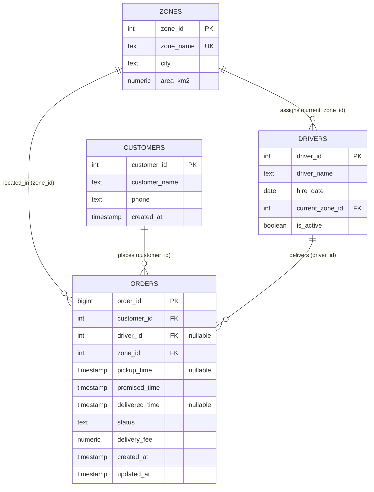
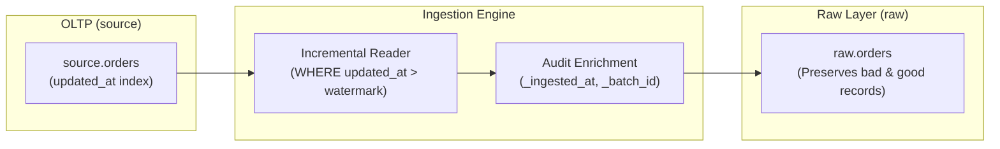

# V1 Architecture & Design Document

**Status:** In Progress (Week 3)  
**Objective:** Deliver simulated Order & Delivery DB (Source 1) and Ingestion Pipeline into Raw Layer (`raw.orders`).

---

## 1. Scope of V1

- **Source Schema (`source`):** Relational tables representing an operational OLTP PostgreSQL database (`zones`, `customers`, `drivers`, `orders`).
- **Synthetic Data Generation:** Reproducible data generator script (`scripts/generate_source_data.py`) with configurable seed, peak hour load, and intentional defect injection.
- **Raw Layer (`raw.orders`):** Append-only / staging raw schema preserving raw source records with ingestion audit columns (`_ingested_at`, `_batch_id`, `_source_system`).
- **Incremental Extraction:** Batch ingestion pipeline utilizing `updated_at` as a high-watermark to extract newly created and updated orders.
- **Idempotency (NFR-1):** Guaranteed zero duplicate records upon re-running pipeline batches.

---

## 2. Source Schema Data Model (ERD & Relationships)

### 2.1 Entity Relationship Diagram (ERD)

### 2.2 Table Definitions & Relationships

1. **`source.zones` (Reference Data):**
   - Danh mục khu vực giao hàng.
   - Quan hệ: Một zone có nhiều tài xế phụ trách (`zones -> drivers`) và nhiều đơn hàng giao đến (`zones -> orders`).
   - Ràng buộc: `zone_name` duy nhất (`UNIQUE`), `area_km2 > 0`.

2. **`source.customers` (Master Data):**
   - Thông tin khách hàng đặt đơn.
   - Quan hệ: Một khách hàng có thể đặt nhiều đơn hàng (`customers -> orders`).
   - Khóa ngoại: Được tham chiếu bắt buộc từ `orders.customer_id`.

3. **`source.drivers` (Master Data):**
   - Danh sách tài xế giao hàng.
   - Quan hệ:
     - `drivers.current_zone_id` tham chiếu đến `source.zones(zone_id)` (tài xế thuộc một zone chính).
     - Một tài xế nhận giao nhiều đơn hàng (`drivers -> orders`).
   - Ràng buộc: `is_active` mặc định `TRUE`.

4. **`source.orders` (Transactional / Operational Data):**
   - Bảng sự kiện nghiệp vụ cốt lõi, lưu trữ toàn bộ vòng đời của đơn hàng.
   - Khóa ngoại:
     - `customer_id` $\to$ `source.customers(customer_id)` (`NOT NULL`).
     - `zone_id` $\to$ `source.zones(zone_id)` (`NOT NULL`).
     - `driver_id` $\to$ `source.drivers(driver_id)` (`NULL` khi đơn chưa gán hoặc bị hủy sớm).
   - Ràng buộc:
     - `status IN ('CREATED', 'ASSIGNED', 'PICKED_UP', 'IN_TRANSIT', 'DELIVERED', 'FAILED', 'CANCELLED')`.
     - `delivery_fee >= 0`.
   - Indexing & Audit:
     - B-Tree index trên `updated_at`, `driver_id`, `zone_id`, `customer_id`.
     - Trigger `trg_orders_updated_at` tự động cập nhật `updated_at = now()` khi có thao tác `UPDATE`.

---

## 3. Nguồn dữ liệu giả lập (Synthetic Source Data)

### 3.1 Quy mô dữ liệu (Scale)
- **Khu vực giao hàng (`source.zones`):** 12 khu vực đại diện các quận nội thành và ngoại thành TP.HCM (Quận 1, 3, 5, 7, 10, Bình Thạnh, Phú Nhuận, Gò Vấp, Tân Bình, Thủ Đức, Bình Tân, Quận 12).
- **Tài xế (`source.drivers`):** 80 tài xế, trong đó ~90% tài xế đang active.
- **Khách hàng (`source.customers`):** 20,000 khách hàng với thông tin tên tiếng Việt và số điện thoại.
- **Đơn hàng (`source.orders`):** 100,000 đơn hàng trải dài trong 90 ngày (từ 2026-07-01 đến 2026-09-28).

### 3.2 Quy ước thời gian
- Mọi trường `TIMESTAMP` được hiểu ngầm là **giờ Việt Nam (UTC+7)**, dạng naive timestamp (không kèm thông tin timezone trong cột database để nhất quán với hệ thống OLTP nội địa).
- Dữ liệu lịch sử hoàn toàn cố định, không sử dụng `now()` động trong quá trình sinh dữ liệu nhằm đảm bảo tính bất biến qua các lần chạy.

### 3.3 Các quy luật vận hành thực tế được mô phỏng
1. **Giờ cao điểm (Peak Hours):**
   - Đơn hàng tập trung cao vào các khung giờ ăn trưa (11:00–12:59) và ăn tối (18:00–19:59).
   - Xác suất giao hàng trễ trong giờ cao điểm tăng thêm **8%** so với giờ bình thường.
2. **Khoảng cách và đặc thù khu vực (Zone Delays):**
   - Các quận trung tâm (Quận 1, Bình Thạnh, Quận 7) có mật độ đơn hàng cao hơn.
   - Các khu vực ngoại thành có diện tích rộng (Thủ Đức, Bình Tân, Quận 12) được cài đặt xác suất giao hàng trễ cao hơn (+6% đến +7%) so với các quận nội thành nhỏ gọn (Quận 3, Quận 5, Phú Nhuận: +0% đến +1%).
3. **Phân bổ tài xế:**
   - 90% đơn hàng được ưu tiên nhận bởi tài xế thuộc zone tương ứng; 10% được hỗ trợ chéo bởi tài xế từ khu vực lân cận.
4. **Đơn hàng đang xử lý (In-flight Orders):**
   - Khoảng 40% đơn hàng phát sinh trong 24 giờ cuối cùng của chu kỳ 90 ngày vẫn ở các trạng thái đang thực hiện (`CREATED`, `ASSIGNED`, `PICKED_UP`, `IN_TRANSIT`). Các trường `delivered_time` hoặc `pickup_time` có giá trị NULL là hoàn toàn hợp lệ về mặt nghiệp vụ.

---

## 4. Quy trình trích xuất và nạp (Source $\to$ Raw)

- Dữ liệu thô tại `raw.orders` giữ nguyên vẹn 100% dữ liệu gốc từ `source.orders` (bao gồm cả các bản ghi có lỗi cài cắm như `DELIVERED_NO_TIME`, `DELIVERED_BEFORE_PICKUP`, `FEE_MISSING`...) để phục vụ kiểm toán và xử lý lỗi tại tầng Staging (V3/V6).
